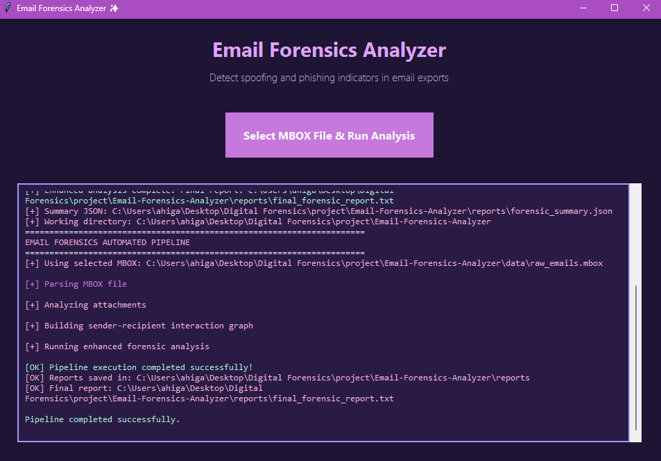

# Email Forensics Analyzer



A modular email forensic analysis tool that detects spoofing and phishing indicators in MBOX email exports. The tool analyzes email headers, attachments, and authentication results to generate comprehensive forensic reports with severity scoring.

## Features

- **Header Analysis**: Detects From/Return-Path mismatches, Reply-To inconsistencies, and Message-ID domain anomalies
- **Authentication Checks**: Parses SPF and DKIM results from Authentication-Results headers
- **Attachment Inspection**: Identifies suspicious file types, calculates SHA-256 hashes for evidence integrity, and flags oversized files
- **Scoring System**: Assigns suspicion scores (0-15+) and maps to severity levels (Low/Medium/High)
- **Multiple Output Formats**: Generates JSON, CSV, and human-readable TXT reports
- **Cross-Platform**: Works on Windows, Linux, and macOS

## Detection Rules and Scoring

| Indicator | Score | Description |
|-----------|-------|-------------|
| From vs Return-Path mismatch | +3 | Different domains in From header and Return-Path |
| Reply-To mismatch | +2 | Reply-To address differs from From address |
| SPF/DKIM fail | +3 | Authentication results indicate SPF or DKIM failure |
| Missing Authentication-Results | +1 | No authentication headers present |
| Suspicious attachment | +3 | Attachment has dangerous extension (.exe, .docm, etc.) or exceeds 5MB |
| Message-ID domain mismatch | +1 | Message-ID domain does not match sender domain |

### Severity Thresholds

- **Low**: Score 0-2
- **Medium**: Score 3-5
- **High**: Score 6+

## Installation

1. Clone the repository:
```bash
git clone https://github.com/Lamia666-sudo/Email-Forensic-Analyzer.git
cd Email-Forensic-Analyzer
```

2. Create and activate a virtual environment:
```bash
# Windows
python -m venv venv
venv\Scripts\activate

# Linux/macOS
python3 -m venv venv
source venv/bin/activate
```

3. Install dependencies:
```bash
pip install -r requirements.txt
```

## Usage

### Quick Start (GUI)

Run the graphical interface:
```bash
python gui_launcher.py
```

Click "Select MBOX File & Run Analysis" to choose your MBOX file and begin analysis.

### Command Line

Run the unified pipeline:
```bash
python pipeline.py path/to/your/file.mbox
```

A sample file is provided in `samples/sample_emails.mbox` for testing.

### Manual Step-by-Step

For debugging or custom workflows, run individual steps:

1. Parse MBOX file:
```bash
python parser/mbox_reader.py samples/sample_emails.mbox
```

2. Analyze attachments:
```bash
python analysis/attachment_checks.py
```

3. Build interaction graph:
```bash
python analysis/interaction_graph.py
```

4. Generate final report:
```bash
python analysis/enhanced_analysis.py
```

## Output Files

All reports are saved to the `reports/` directory:

- `messages.json` - Structured message data with all analysis results
- `timeline.csv` - Chronological timeline of all emails
- `attachment_report.json` - Detailed attachment analysis with SHA-256 hashes
- `final_forensic_report.txt` - Human-readable summary report
- `forensic_summary.json` - Aggregated statistics by severity and flag type

## Security Warning

**Run in a Virtual Machine**: This tool extracts email attachments to disk. For safety, always run analysis in an isolated virtual environment when processing potentially malicious emails. Never open suspicious attachments directly.

## Sample Report

```
FINAL EMAIL FORENSIC REPORT
============================================================

Total messages analyzed: 3

Summary by severity:
  - Low: 1
  - Medium: 1
  - High: 1

Top flags observed:
  - From vs Return-Path mismatch: 2
  - Suspicious attachment: 1
  - Message-ID domain mismatch: 2

DETAILED MESSAGES
------------------------------------------------------------
Message ID : <msg0@example.com>
From       : attacker@fake-vendor.co
To         : accounts@company.com
Subject    : URGENT: Invoice #INV-884701 Payment Required
Date       : 2024-01-15T10:30:00
Severity   : High (score 12)
Flags      :
  - From vs Return-Path mismatch
  - SPF/DKIM fail
  - Message-ID domain mismatch
Attachments :
  - msg0_Invoice_INV-884701.pdf (suspicious=False, size=59, sha256=...)
```

## Project Structure

```
Email-Forensics-Analyzer/
├── analysis/
│   ├── attachment_checks.py      # Attachment analysis with SHA-256 hashing
│   ├── enhanced_analysis.py     # Final scoring and report generation
│   └── interaction_graph.py      # Sender-recipient relationship mapping
├── parser/
│   └── mbox_reader.py            # MBOX parsing and extraction
├── scripts/
│   ├── regen_check.py            # Test/regeneration script
│   └── rotate_reports.py         # Report management utilities
├── data/
│   └── attachments/               # Extracted attachments (do not commit)
├── samples/
│   └── sample_emails.mbox         # Sample MBOX file for testing
├── reports/                      # Generated reports (do not commit)
├── gui_launcher.py               # GUI interface
├── pipeline.py                   # Unified analysis pipeline
├── requirements.txt              # Python dependencies
└── README.md
```

## Authors

Developed by Lamiaa Ahmed Higazi

## License

This project is licensed under the MIT License - see the [LICENSE](LICENSE) file for details.

## Contributing

Contributions are welcome. Please ensure any test data is synthetic and does not contain real personal information.

## Limitations

- **Authentication Parsing**: The tool parses SPF and DKIM results from Authentication-Results headers but does not perform independent DNS verification. It relies on the receiving mail server's authentication results.
- **Domain Comparison**: Organizational domain extraction uses a simple heuristic (taking the last two parts of a domain). This may not work correctly for all country-code TLDs (e.g., .co.uk).
- **Attachment Analysis**: File type detection is based on extension only. Magic number (file signature) analysis is not implemented, so renamed executables may evade detection.
- **URL Analysis**: The tool does not extract or analyze URLs from email bodies for link text vs destination mismatches.
- **False Positives**: Legitimate mailing services and newsletters may trigger From/Return-Path mismatches. Manual review is recommended for Medium and High severity messages.
- **Scope**: The tool focuses on header analysis and basic attachment inspection. It does not perform content analysis, behavioral analysis, or threat intelligence lookups.
